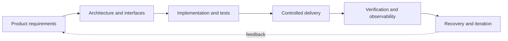

# Mr.OLDMAN

### Systems Engineering · Platform Architecture · Secure Infrastructure

**Designing reliable digital systems — from product strategy to production operations.**

---

## Profile

I work at the intersection of **software engineering, infrastructure architecture, data systems, and business strategy**. My approach connects product objectives with secure deployment, operational resilience, and measurable outcomes.

My background includes leading development and marketing at an international investment holding and building vertically integrated business operations. Today, that systems-level perspective informs how I design and deliver digital platforms: **end-to-end ownership, clear operational boundaries, disciplined change management, and repeatable verification.**

## Engineering focus

| Domain | Engineering practice |
|:--|:--|
| **Platform architecture** | Multi-service applications, control planes, API gateways, backend integration, service boundaries |
| **Infrastructure & operations** | Linux, Nginx, systemd, Docker, SSH, TLS, deployment workflows, service health |
| **Networking & security** | WireGuard, Xray, reverse proxies, tunnel-based administration, least-privilege access, credential isolation |
| **Data & automation** | PostgreSQL, SQLite, Python, REST APIs, operational automation, analytical pipelines |
| **Reliability & recovery** | Encrypted backups, restore testing, versioned configuration, integrity checks, reproducible rollbacks |
| **Product engineering** | Web interfaces, subscription workflows, customer portals, billing integration and business analytics |

<b>Explore the engineering approach</b> · architecture and delivery

### From specification to verified release

**Operational principles:** minimal exposure · explicit access boundaries · encrypted recovery · tested rollbacks · traceable changes · verification before release.

## Technology landscape

  
  
  
  
  
  
  
  
  
  

<b>Full stack & toolchain</b> · expand

| Layer | Technologies & capabilities |
|:--|:--|
| Application | Python, JavaScript, HTML, CSS, Django, Flask, REST APIs, SQLAlchemy |
| Frontend | React, Tailwind CSS, Fetch API, responsive UI components |
| Data | PostgreSQL, SQLite, JSON, XML, Power BI, DAX |
| Infrastructure | Ubuntu/Linux, Nginx, Docker Compose, systemd, SSH, WireGuard, TLS, Cloudflare |
| Delivery | Git, GitHub, GitLab CI/CD, Ansible, shell/Python automation |
| Assurance | Restic, age encryption, SHA-256 verification, backup/restore testing, logging and rollback |
| Developer tooling | VS Code, Codex, Homebrew, Postman, Ruff, Black, ESLint, Prettier |

## Selected work

| Initiative | Scope |
|:--|:--|
| **Secure distributed services** | Distributed service architecture, private control planes, encrypted delivery, network routing, resilient operations and verified recovery. *Implementation details remain private.* |
| [**SoundBloqs Community**](https://soundbloqs.com/) | Community platform for art, sound, and creative collaboration |
| [**TrustMoney.Club**](https://club.trustmoney.uk/) | Digital presence for a finance-focused community |
| [**TrustMoney.UK**](https://trustmoney.uk/) | International business and consulting presence |
| [**TrustMoney Telegram**](https://t.me/tmclubinfo_bot/) | Messaging and automated information delivery |

<b>Open-source repositories & experiments</b> · expand

**Python / APIs / architecture**

- [Clipboard analysis](https://github.com/whoisoldman/analyze_clipboard_text) · [Flask calendar API](https://github.com/whoisoldman/api_flask_calendar) · [Abstraction & composition](https://github.com/whoisoldman/abstraction_composition_coupling_cohesion)
- [Consumer supply](https://github.com/whoisoldman/consumer_supply) · [Django ORM](https://github.com/whoisoldman/django_orm) · [OAuth project](https://github.com/whoisoldman/oauth_project)
- [REST API e-shop](https://gitlab.com/ps_learning/ps-learning-python-rest-api-eshop) · [Flask / SQLAlchemy](https://gitlab.com/ps_learning/ps_learning_flask_sqlalchemy) · [Bookstore](https://gitlab.com/ps_learning/ps_learning_bookstore)

**JavaScript / UI**

- [React dice](https://github.com/whoisoldman/dice_react_app) · [React hooks](https://github.com/whoisoldman/react_hooks_homework) · [Task manager](https://xwwjqs.csb.app/) · [Anime timer](https://gdrhwf.csb.app/)

[Browse repositories](https://github.com/whoisoldman?tab=repositories)

## GitHub activity

  
  

Statistics are rendered from locally maintained SVG assets. Private activity visibility follows GitHub profile settings; language charts reflect repository composition, not proficiency.

<b>Education & professional development</b> · expand

- **2000** · Director & Sound Engineer — [GITIS](https://gitis.net/en/)
- **2004** · International Business & Economics — [RSUH](https://www.rsuh.ru/en/)
- **2023** · Marketplace Management — [Yandex Practicum](https://practicum.yandex.ru/)
- **2024** · Data Analytics — [Financial University](https://en.fa.ru/)
- **2025** · Python, Full-stack, DevOps & Data Science — [ProductStar](https://productstar.ru/)

---

**Systems thinking. Security by design. Verification before release.**

[Contact](https://www.soundbloqs.com/contact/) · [GitHub](https://github.com/whoisoldman) · [Telegram](https://t.me/soundbloqsfb_bot)

<!--
LEGACY README — preserved from the supplied previous version; HTML comment delimiters inside are entity-escaped so the entire historical version remains hidden from GitHub rendering.

&lt;!--
* 🔬 [text](https://link.com)
* 📈 [text](https://link.com)
; 🔍 [text](https://link.com)
* 🤖 [text](https://link.com)
* 🎧 [text](https://link.com)
* 🧭 [text](https://link.com)
* 🧱 [text](https://link.com)
* 🔧 [text](https://link.com)
* 🛒 [text](https://link.com)
* 📚 [text](https://link.com)
* 🔄 [text](https://link.com)
* 🧬 [text](https://link.com)
* 🔐 [text](https://link.com)
* 🧹 [text](https://link.com)
* ⏳ [text](https://link.com)
* 📋 [text](https://link.com)
* 🎲 [text](https://link.com)
* 🛠 [text](https://link.com)
--&gt;
# Hi 👋, I'm Mr.OLDMAN

I have extensive experience in marketing and business development. I started as a regular clerk and grew into the role of Development and Marketing Director at a large international investment holding. During that time, I successfully built a highly profitable business with a vertically integrated management structure.

However, that was my previous chapter. I am now focused on acquiring new skills related to internet business, web presence, data analytics, and software development. I am also actively learning query languages and analytical functions.

---

### 🎓 Education:
* [2000] Director, Sound Engineer (1-st higher education) — [Russian Academy of Theatre Arts (GITIS)](https://gitis.net/en/)
* [2004] International Business, Economist (2-nd higher education) — [Russian State University for the Humanities (RSUH)](https://www.rsuh.ru/en/)
* [2023] Marketplace Manager (advanced) — [Yandex Practicum](https://practicum.yandex.ru/)
* [2024] Data Analyst (advanced) — [Financial University under the Government of the Russian Federation](https://en.fa.ru/)
* [2025] Python Developer (Fullstack, DevOps and Data Science) — [ProductStar by RBC](https://productstar.ru/)

---

### 📊 GitHub Stats:

  
  

&lt;!-- 

  
  

 --&gt;

---

### 🗝 Key Projects
* 🎧 Pet Project: [SoundBloqs Community](https://soundbloqs.com/) — community web platform for Arts
* 💰 Finance Market: [TrustMoney.Club](https://club.trustmoney.uk/) — digital presence for the Club
* 💰 Finance: [Telegram Bot for TrustMoney.Club](https://t.me/tmclubinfo_bot/) — Telegram resource
* 🌍 Finance: [TrustMoney.UK](https://trustmoney.uk/) — global consulting project (money transfers, trading, M0-M1, VISA.NET, investments, energy, gold, food, blockchain, crypto and more...)
* ✍️ Writing about software development, music, art and the people who make the world a better place

---

## 🛠 Technical Stack

### 🔧 Programming Languages & Core Technologies
- **Python**
- **JavaScript**
- **HTML**
- **CSS**

---

### 🧩 Frameworks & Libraries

#### Backend
- **Django** (ORM, Admin, Middleware, Migrations, DRF)
- **Flask**
- **SQLAlchemy**
- **Gunicorn**

#### Frontend
- **React**
- **Tailwind CSS**
- **Framer Motion**
- **ShadCN/UI**
- **Lucide Icons**
- **AJAX / Fetch API**

---

### 🗄️ Databases & ORM
- **PostgreSQL**
- **SQLite**
- **SQLAlchemy**
- **Django**

---

### 🔗 API Development & Data Formats
- REST API (development & integration)
- **Postman** (testing & documentation)
- **JSON, XML** (data formats)

---

### ⚙️ DevOps / CI-CD / Infrastructure
- **Git** (GitHub, GitLab)
- **GitLab CI/CD** (pipelines & VDS deployment)
- **Docker & Docker Compose**
- **Ansible** (Thanks: [Pavel Semchenko](https://github.com/Bumeranghc))
- **Nginx** (static content, proxying)
- **.env** configuration
- **RDP** via Parallels Desktop (macOS)

---

### 🧪 Testing & Debugging
- **Postman** (manual API testing)
- Django Testing Framework (basic level)
- Python `pdb`, logging tools

---

### 🧰 Tooling & Developer Environment
- **macOS**
- **VSCode**
- **Parallels Desktop** (VM)
- **Homebrew**

---

### 🔍 Code Quality & Automation
- **Prettier**
- **ESLint**
- **Husky** (Git Hooks)
- **Ruff** (Python linter)
- **Black** (Python formatter)

---

### 🧑‍💻 Areas of Focus
- Web app and REST API development
- Data visualization with React & Tailwind
- Workflow automation and CI/CD pipelines
- Relational databases and ORM
- Deployment to VDS via GitLab CI/CD
- SMM & SEO integrations using Python and JS
- Internal apps for order/project tracking
- Integration with third-party REST APIs

---

### 🧭 Bonus (Optional Additions)
- Pytest (testing)
- Celery + Redis (background tasks)
- Alembic (SQLAlchemy migrations)
- React Router (routing)
- Zustand / Redux (state management)
- FastAPI (alternative to Flask)
- Poetry / `uv` (dependency management)
- Sentry / Loguru (monitoring and logging)

---

### 🌱 Open Source Projects

* [analyze_clipboard_text](https://github.com/whoisoldman/analyze_clipboard_text.git)
* [api_flask_calendar](https://github.com/whoisoldman/api_flask_calendar.git)
* [abstraction_composition_coupling_cohesion](https://github.com/whoisoldman/abstraction_composition_coupling_cohesion.git)
* [flask_sqlalchemy](https://gitlab.com/ps_learning/ps_learning_flask_sqlalchemy.git)
* [python_rest_api_eshop](https://gitlab.com/ps_learning/ps-learning-python-rest-api-eshop.git)
* [bookstore](https://gitlab.com/ps_learning/ps_learning_bookstore.git)
* [consumer_supply](https://github.com/whoisoldman/consumer_supply.git)
* [django_orm](https://github.com/whoisoldman/django_orm.git)
* [oauth_project](https://github.com/whoisoldman/oauth_project)
* [ruff_fixes](https://github.com/whoisoldman/Architecture-and-backend-homework/tree/ruff-fixes)
* [anime_timer](https://gdrhwf.csb.app/)
* [js_taskmanager_linkedlist](https://xwwjqs.csb.app/)
* [react_dice](https://github.com/whoisoldman/dice_react_app)
* [react_custom_hooks](https://github.com/whoisoldman/react_hooks_homework.git)
* Not finished [Transliteration *.exe-portable](https://disk.yandex.ru/d/9-9RbX51eJdwGA)
* Not finished [EyeRelaxPro *.exe-portable](https://disk.yandex.ru/d/OB48CkN19t686Q)
* More coming soon...

---

### 🛒 Commercial Projects

* Not finished [MEDIA→TXT]
* More coming soon...

---

## 📈 Analytical Stack

- Microsoft Fabric (Power BI)
- DAX
- Measures

### 📊 Analytical Projects

* [Analytical Cases](https://drive.google.com/drive/folders/1JoBl2rzQxHlUBRNQ2hr88FD4KPltbV8x?usp=sharing)
* More coming soon...

---

  MailBox by 

  How to reach me: <a href="https://www.soundbloqs.com/contact/">Mr.OLDMAN's Contact Form</a>

END OF LEGACY README
-->
